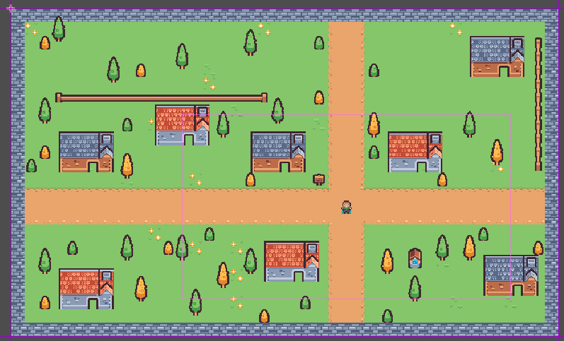

# caos-no-canion

## Carta

Tema: Cânion com pedras rolantes
Tipo: Defesa
Objetivo: Proteger por 3 minutos um objeto fixo, que aguenta 5 toques de inimigo
Modo: Horda

## Créditos

- Tileset: Tiny Town, de Kenney -- https://kenney.nl/assets/tiny-town -- licença CC0
- Personagem: Prof. Ezefferth, para a Aula 08 de Jogos Digitais II